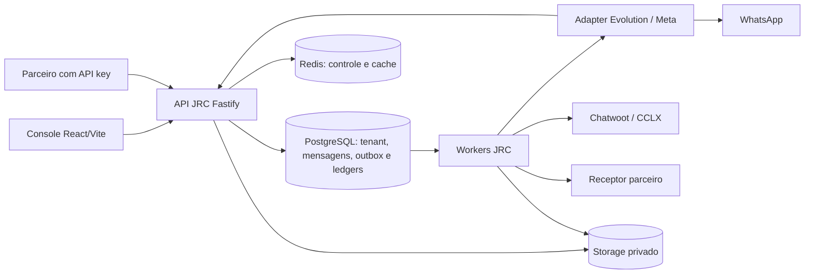

# Arquitetura técnica — base real e evolução delimitada

Base inspecionada d1b66a em30/10/2026. Não se propõe reescrever o produto. Broker2 deve evoluir as fronteiras existentes preservando contratos próprios JRC.

## Fluxos e autoridade

PostgreSQL é a fonte durável das principais filas Broker. Redis não substitui a outbox. A engine possui persistência própria; origem→Broker é uma fronteira de durabilidade distinta da entrega Broker→parceiro. Console chama API JRC; detalhes internos da engine ficam nos adapters.

| Fronteira | Implementação existente | Invariante |
|---|---|---|
| Tenant/autorização | tenant-transaction, membership, RLS/roles e scopes | Tenant do principal, nunca confiar no body |
| Mensagens/efeitos | messaging/repository, dispatcher, operações e leases | Intenção idempotente; resultado incerto não vira reenvio novo |
| Parceiro | partner-events/worker.ts e migration0077 | eventId/tenant estáveis, HMAC dos bytes, lease fenced, ACK após persistência no consumidor |
| Mídia | messaging/private-object-store, media-custody | Leitura privada e tenant-safe; recibo declaratório não é prova física |
| Identidade | chatwoot-health e control-service | Fingerprint por org/canal; confirmação explícita; credencial/destino atuais |
| Automações | workers, sandbox, IO e scheduler separados | Autoridade e ownership revalidados antes do efeito |
| Lifecycle | migrations e catálogo de purge | Remoção coordenada, preservando integridade; KEEP não elimina autoridade administrativa existente |

## Piloto H01: diagnóstico de saúde confiável

Em `apps/api/src/modules/integrations/chatwoot-control-service.ts:127-151`, a saúde reúne inbound/outbound posteriores à confirmação de identidade, callback ligado a destinationRevision/credentialVersion e conexão observada. A expressão failure faz EXISTS de qualquer FAILED/UNKNOWN sem prazo ou prova de superação. O helper `deriveTransportStatus` só recebe booleanos, portanto seu teste não pega a classificação histórica incorreta.

Há também leitura inicial de mapping e revalidação final cujo resultado é descartado; o retorno continua usando status/last_error iniciais. Deve-se testar mudança de estado durante I/O antes de afirmar que o diagnóstico representa a configuração atual.

Escopo sugerido: separar extração/classificação da evidência de saúde, com relógio explícito para testes e mapping final atual. Definir política para FAILED superado por evidência mais nova no mesmo domínio; UNKNOWN não resolvido continua crítico mesmo antigo. Manter histórico e contadores acessíveis. Não usar expiração arbitrária de24h como resolução de UNKNOWN. Não reabrir mensagem, limpar tabela, mudar binding nem parear no endpoint de status.

A API atual expõe integrationStatus, instanceStatus, transportStatus, callbackVerifiedAt, sucessos inbound/outbound, identidade e ações permitidas. Reutilizar esses campos e seus contratos antes de adicionar outros; qualquer novo estado exige schema+UI+negativos consistentes.

## Testabilidade e concorrência

Factories existentes permitem injetar transact, readIdentity, instances, auth, health e transporte. Usar essas interfaces para reproduzir serviço completo com dados sintéticos e assertivas de efeito proibido. Em seguida usar PG isolado para provar SQL/RLS/lock real. Mock de query por substring pode testar orquestração, mas não valida semântica SQL.

Para parceiro, `createPartnerEventWorker` recebe send/now/claim/authorize/settle. Harness integrado deve conservar claim/authorize/settle reais com PG e injetar apenas transporte. URL sintática HTTPS de laboratório deve ser exigida por igualdade; encaminhamento local fica no harness, sem afrouxar SSRF produtivo.

## Decisões ainda abertas

Política temporal de falha ativa; catálogo de motivos operacionais versus erros de transporte; ordenação comum poll/webhook; captura durável na origem; orçamento de pools/rollout; RPO/RTO; mix/SLO de benchmark. Cada decisão precisa teste que reproduza o risco e evidência da fronteira afetada. Esta arquitetura não declara tais decisões implementadas.
