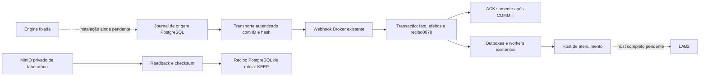

# Arquitetura e contratos

## Atualização da continuação ea58 — 01/11/2026

O incremento corrente está detalhado em 10-INCREMENTO-ORIGEM-CUSTODIA-20261101.md. Há agora recibo opt-in no endpoint existente, ledger Broker0078 e transporte real testado contra HTTP/SQL do Broker. Isso substitui a afirmação histórica de ausência desse ACK. O bootstrap instalado da engine ainda não existe; a flag continua bloqueada por ownership UNPROVEN.

Linhas pontilhadas são integrações ainda não homologadas. A prova de LAB2 executa sua classe Ruby real de validação de resposta, não todo o host. A custódia S3 do receptor é de laboratório e não autoriza exclusão na origem. Redis continua auxiliar; nenhuma outbox PostgreSQL foi substituída.

## Arquitetura e decisões anteriores preservadas

Chatwoot ↔ API/conector Broker ↔ Evolution/Baileys privada ↔ WhatsApp. Meta é provider separado. Fastify/TypeScript, PostgreSQL durável, Redis auxiliar, workers, React/Vite e storage privado existentes.

Parceiro, organização, loja, canal, instância, inbox e engine são entidades distintas. Preservar RLS, membership, grants e revisão de vínculo. LAB2 não é fork CCLX. Um controlador e um proprietário de envio por sessão/inbox.

Ver matriz de APIs e arquitetura em ../broker-jrc-2-redesign-homologacao/03-ARQUITETURA-TECNICA.md e ../auditoria-900/07-MATRIZ-APIS.md. Esses inventários precisam reconciliação com o próximo SHA; não equivalem a endpoints novos. Nenhuma nova rota pública prevista neste incremento.

B07 trata a corrida polling/webhook; H01 trata diagnóstico e não altera autorização de envio. UNKNOWN continua resultado incerto e não autoriza retry.

AUD-B02: metadadosOCI/in-totoSLSAv0.2 do digest auditado apontam para cd800f2976e1e5b682fbf86a01ee4d85ae61f370. Comparação selecionada src/prisma/package/lock/Dockerfile comfa09não mostrou diferenças. Isso não é rebuild reproduzível nem prova do processoimplantado. A Promisevolátil anterior ao webhook continua semjournalatômico. Evidênciaeprimeiroincremento em evidencias/b02-source-20261101.md. Nenhum patchengine aplicado.

## Novos componentes isolados

- integrations/evolution-origin-journal/: esquema PostgreSQL engine-owned jrc_evolution_origin, conteúdoallowlisted cifradoAES-GCM, aceite/transação,lease/fence,tentativaseretido,portadeentregainjetada,preparaçãodehooksourcehashfixado. DDLnão pertenceaojournalDrizzle77e nãofoiaplicadoaoBroker. Nenhumbootstrapéinstalado. OACKatual200accepteddoBroker não satisfaz essecontrato experimental; deveexistiradaptadorrealidempotenteantesdeativar. Rollbackimediatoémanterflagdesabilitada/preservarjournal; nuncaDROPprodutivo.
- labs/cclx-postgres-simulator/: receptor sintético emPGcomACKapósCOMMIT,inbox/projeçãoatômicos,dedupe/HMAC,hash/tamanhodacópiaprivada eACKde mídia separado. COPY_PERSISTED_UNVALIDATED e sourceEligibleForDeletionfalse; nãoautorizaexpurgo. NãoéendpointBroker,nãoinstalaHTTP,nãoéCCLXreal.

Novassuites estãoincluídas emCI eworkflowdeimagens. Metadata/protocolodestecomponente nãoépublicaçãoautomática decontratoAPI. Licenças/atribuiçõesupstreampreservadas; submódulointacto.
