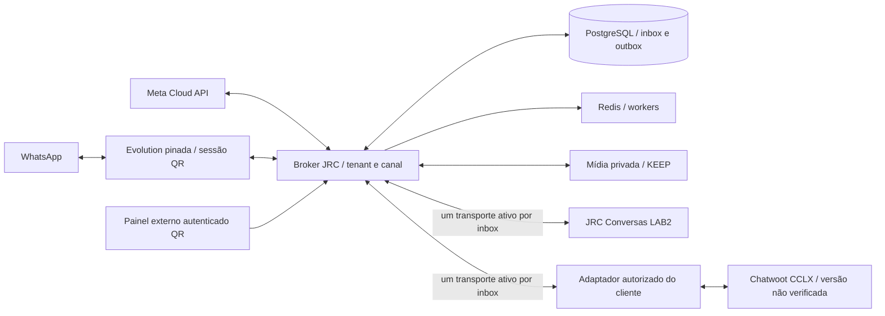

# Escopo comum Broker ↔ consumidores Chatwoot

Escopo comercial confirmado em02/11/2026: Broker JRC é SaaS multiempresa próprio; Evolution pinada permanece engine QR e Meta Cloud API permanece provider oficial. JRC Conversas LAB2 e instalação CCLX são consumidores independentes. O CCLX não precisa adotar o fork completo LAB2.

Este documento identifica contratos existentes e obrigações de integração. Não inventa novas rotas, declara instalação nativa ou promete equivalência de recursos entre providers. A implementação efetivamente validada nesta rodada é o recorte Sidekiq e a reautorização do componente externo QR; demais provas anteriores continuam datadas.

## Arquitetura preservada

Existem dois modos de integração: conector Chatwoot mantido pelo Broker, ou consumidor próprio usando API/eventos de parceiro. Selecionar um único proprietário da entrega por inbox. Não ligar os dois caminhos ao mesmo tempo nem retirar Cloud Functions/PubSub/n8n/QuePasa antes da equivalência comprovada. Outbox PostgreSQL não é substituída por Redis.

## Identidades e autoridade

| Identidade | Contrato / persistência | Regra |
|---|---|---|
| Empresa | organizationId / tenant Broker | Chave de parceiro restrita à empresa; não derivar tenant pelo telefone do contato |
| Instalação Chatwoot | origem autorizada + Account e revisão de destino | Mesmo accountId numérico em duas instalações não é a mesma conta |
| Canal | channelId; instanceId para QR ou ativos Meta associados | Provider e capabilities explícitos; conexão não comprova entrega |
| Associação | integrationId + inboxId + revisão | Fences contra troca de caixa/destino/identidade; nenhuma adoção pelo nome da inbox |
| Mensagem | id persistido na origem + messageId/eventId + IDs do destino | Retries preservam identidade e conteúdo; não criar novo POST lógico para resolver UNKNOWN |
| Entrega | deliveryId / endpointId / organização | ACK de transporte e recibo de persistência são contratos diferentes |
| Mídia | mediaId + tamanho + SHA256 + recibo | URL temporário não é armazenamento definitivo; KEEP até critério adequado |
| Sessão do operador | grant do host + recursos permitidos + CSRF | Credencial permanente fica no backend. Revalidar no início, antes de mutar e antes de responder |

No LAB2 existem JrcBrokerIntegration e JrcBrokerInboxBinding com Account/inbox/instance/integration. A obrigação transacional do commit01fd99c6 mantém fingerprint e UUID de entrega. O kit Node `integrations/partner-qr` é independente do código Rails: exige callbacks de sessão e resolução de credencial do host, sem embutir chave no navegador. Esses callbacks e seu armazenamento ainda precisam ser instalados/autorizados no ambiente do cliente.

## Rotas existentes a consumir

Fonte: OpenAPI versionada atual e matriz de356 operações. As rotas têm autenticação/escopos distintos; uma API key de QR não autoriza automaticamente APIs administrativas, Meta ou mensageria. Não executar exemplos contra produção durante homologação.

| Função | Método e rota real | Limite |
|---|---|---|
| Instâncias QR | GET/POST `/v1/instances`, GET `/v1/instances/{id}` | Metadata por tenant; provider BAILEYS no kit QR |
| Parear/reconectar | POST `/v1/instances/{id}/connect` | Idempotency-Key e resultado pendente/incerto; QR pode expirar |
| Desconectar | POST `/v1/instances/{id}/disconnect` | Mutação administrativa, não é revogação de chave |
| Controle Chatwoot delegado | GET `/v1/integrations/chatwoot/control/context`, GET `/resources` no mesmo prefixo | Chave delegada, origem/Account/vínculo e RBAC |
| Parear inbox mapeada | POST `/v1/integrations/chatwoot/control/connections/{integrationId}/pair` e GET `/pair-operations/{operationId}` no mesmo prefixo | Não prometer que emitir QR vincula a sessão física |
| Estado da inbox | GET `/v1/integrations/chatwoot/control/connections/{integrationId}/status` | Sessão, identidade, transporte e entrega distintos |
| Receber eventos Chatwoot | POST `/v1/integrations/chatwoot/{id}/events` | HMAC/identidade/escopo do vínculo; webhook não pode criar loop |
| Envio parceiro | POST `/v1/messaging/channels/{id}/partner-text` e `/partner-media` | Autoridade e capabilities do canal; aceitação não equivale a entrega |
| Mídia privada | POST `/v1/messaging/channels/{id}/media`, GET `.../media/{mediaId}` | Upload/consulta autorizados; não compartilhar bucket/credencial da engine |
| Consulta | GET `/v1/messaging/channels/{id}/conversations`, GET `/v1/messaging/conversations/{id}/messages` | Histórico do escopo autorizado, não todo o telefone/tenant |
| Eventos parceiros | GET `/v1/partner-events`, GET/POST `/v1/partner-webhooks` | Cursor/retenção explícitos, HMAC bruto e inbox idempotente no receptor |
| Delivery / recibo | GET `/v1/partner-webhook-deliveries` e GET `/v1/partner-webhook-delivery-stats` | HTTP legado ou PERSISTENCE_RECEIPT_V1 negociado; não confundir com custódia |
| Custódia | POST `/v1/media-custody/receipts`, GET `/v1/media-custody/receipts/{id}/retention` | Recibo não promove physicalStorageVerified nem libera expurgo |
| Meta onboarding | POST `/v1/meta-onboarding/start`, POST `/complete` no mesmo prefixo | Fluxo e autorização próprios do portal; kit QR não implementa esse onboarding |

O contrato estrito de ACK está em `docs/api/partner-webhooks.md`: oito campos, JSON estrito, correlação de tenant/endpoint/event/delivery, recibo persistido após COMMIT e ID estável no retry. A mensagem Chatwoot→Broker usa assinatura/UUID do webhook Chatwoot, não o schema do recibo Broker→parceiro. Não usar uma assinatura para validar o outro sentido.

## CCLX: legado e extensão

Fluxo de saída informado pelo cliente: **Chatwoot → Cloud Functions → Pub/Sub → n8n → QuePasa**. A ordem e os contratos de entrada ainda não foram fornecidos. Esse fluxo é relato, não código/infraestrutura inspecionados. Versão exata/fork, tecnologia de Pub/Sub e extensões permitidas permanecem não verificados. Referências históricas3.x não substituem consulta atual.

| Regra do cliente | Evidência necessária antes de substituir | Responsável |
|---|---|---|
| Lookup por telefone | Normalização/E.164/JID/LID, instalação/loja e conflito entre contatos | Cliente + adaptador |
| Contato/conversa/protocolo | Chave externa, criação idempotente, reabertura e autoridade do protocolo | Cliente |
| Filas/departamentos/atribuição | Mapeamento de time/agente por inbox, disponibilidade e handoff do bot | Cliente + integração |
| Campanhas / privadas | Exemplos de eventos, marca de origem e filtros que impedem eco | Cliente + integração |
| Mídia | Endpoint privado, validade, hash/tamanho, armazenamento e recibo | Ambos |
| Convivência/corte | Identidades persistidas, backlog, um transporte ativo, rollback de aplicação compatível | Ambos, com autorização específica |

Sem acesso/autorização não será modificado o CCLX. Opções reais a verificar: dashboard app suportada pela versão, painel externo autenticado/link ou BFF da própria instalação. Iframe/link é interface externa integrada; não é módulo nativo. O portal da empresa no Broker pode existir separado; isso não instala a tela na experiência do Chatwoot automaticamente.

## Matriz de aceite vigente

| Requisito | Estado | Evidência / próxima prova |
|---|---|---|
| Mesmo Broker e contratos comuns | PARCIAL | APIs existentes; Meta e QR têm capacidades/autenticações diferentes |
| LAB2 obrigação transacional | VALIDADO NO RECORTE LOCAL |66 RSpec anteriores; agora Sidekiq/Redis reais, SIGKILL após recibo PG, dois accounts; transporte simulado |
| Componente externo QR autenticado | PARCIAL |37 testes; reautorização antes de POST/resposta; depende do host de sessão real |
| Meta no módulo de conexão | PENDENTE DE HOMOLOGAÇÃO | Broker possui onboarding; kit QR não cobre Meta |
| Duas instalações independentes | PENDENTE | Duas contas do LAB2 não satisfazem este requisito |
| Adaptação CCLX e regras legadas | DEPENDENTE DO AMBIENTE CCLX | Versão, acesso autorizado e contratos do legado ainda necessários |
| Bidirecional/mídia real no LAB2 | PARCIAL | Provas anteriores isoladas; falta percurso TLS/provider/custódia completo |
| Sidekiq crash e perda ACK | VALIDADO NO RECORTE LOCAL | Sidekiq7.3.1 real, Redis/PG reais; receptor simulado com recibo real |
| Engine final/ownership | PARCIAL | Pin/journal e regressões preservados; imagem final ainda não homologada |
| CI e releases separados | PENDENTE | Novos commits são locais; nenhuma publicação ou migração produtiva nesta rodada |

Próxima prova independente do CCLX: segundo Chatwoot stock isolado, versão identificada, usando o contrato público e sem copiar LAB2, mais LAB2 completo no outro lado. Depois, TLS/transportes reais e mídia privada. O aceite no fork CCLX continua separado e exige acesso autorizado. Não ativar números, legados ou campanhas por inferência.
