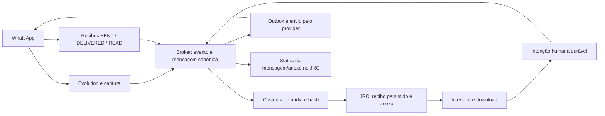

# Validação da pesquisa de mídias — 17/11/2026

## Conclusão

Os documentos fornecidos são coerentes como pesquisa e matriz de testes
propostos. Não são homologação nem autorização automática para ativar captura,
alterar sessões ou ampliar formatos/limites. A tarefa vigente autoriza a
continuação da correção, CI, main, imagens e testes nas duas conversas já
delimitadas; UNKNOWN, privacidade e rotinas excluídas permanecem preservados.

## Validação e atualização da fotografia

- O SHA256 de packages/providers/src/media.ts coincide com a prova fornecida:
  6cb5371160da62d49490b8a00c38b8f082b164ba9200a9c027f935e876a7fe19.
  Todos os 17 resultados foram reproduzidos em Node 24.19.0. A tabela global
  continua rejeitando audio/opus; a candidata normaliza somente o anexo
  canônico de áudio com cabeçalho Ogg/Opus comprovado na fronteira Chatwoot.
- CSV/ZIP ausentes, WebP sempre sticker e limites compartilhados são achados
  confirmados no código; aceitar o formato na tabela não prova transmissão.
- A afirmação de MIME desconhecido ficou superada: o blob sintético e o GET
  real retornaram audio/opus, 440 bytes, OggS/OpusHead e hash preservado.
  E2E 44143283284 passou em e8f83c4, com oito saídas sintéticas em duas
  contas, incluindo a normalização real Rails/ActiveStorage/MinIO.
- F07 existe no fonte Evolution fixado: messages.upsert itera messages e os
  returns do bloco S3 antecedem o fanout. Ainda requer regressão da engine;
  não foi demonstrado como causa dos registros ausentes neste servidor.
- Runtime observado declara Baileys 7.0.0-rc.9. O advisory oficial
  GHSA-qvv5-jq5g-4cgg indica reparos 7.0.0-rc12 e 6.7.22. É necessário
  conferir também o código instalado para excluir backport; número da
  versão, isoladamente, não comprova ausência de patch.

## Três armazenamentos distintos

1. Evolution: S3_ENABLED e S3_SAVE_VIDEO não definidos no container observado;
   o fonte fixado usa habilitação estrita por true. Confirmar equivalência
   do código instalado antes de atribuir o ramo S3 a incidente produtivo.
2. Broker API: MEDIA_STORAGE_DRIVER=postgres, sem configuração S3; nenhuma
   operação de objeto privado S3 registrada neste canal. Mídias READY estão
   sob custódia PostgreSQL legada, não se deve prometer migração automática.
3. JRC: o objeto sintético foi obtido pelo serviço de Active Storage, com
   HTTP 200 e audio/opus. Esse GET comprova o objeto consultado, não todo o
   bucket, todas as permissões ou todas as mídias antigas.

Não habilitar S3 para tentar resolver catálogo, vínculo ou captura. Uma
futura migração de custódia exige plano, prova de bytes, dupla leitura,
compatibilidade e preservação de objetos/recibos antigos.

## Lacunas observadas no canal autorizado

Consultas somente leitura com escopo de tenant/canal, sem conteúdo ou telefones:

- Histórico V2 desativado; zero runs, políticas ou sessões de origem.
  JRC_EVOLUTION_ORIGIN_JOURNAL_ENABLED também não definido na engine observada.
- 31 conversas individuais no Broker, 29 mapeadas ao JRC; seis de grupo,
  duas mapeadas. Mapeamento não comprova que todas as mensagens apareceram.
- Catálogo da engine armazenado: 58 identidades individuais e 12 grupos.
  Comparação exata, considerando aliases PN/LID confirmados do scope atual:
  39 identidades individuais e seis grupos sem correspondência comprovada.
  Não são necessariamente 39 pessoas distintas; catálogo da engine não
  prova cobertura integral do telefone.
- Catálogo de grupos vencido, PROVIDER_REQUEST_FAILED, 12 itens e zero
  selecionados. Há 388 falhas GROUP_CENTRAL_SCOPE_CHANGED; seis registram
  GROUP_NOT_SELECTED, 382 não retêm submotivo. Não adivinhar o motivo antigo.
- 1.486 MIRROR_MESSAGE PENDING com attempts=0, entre 20/10 e 17/11;
  61 CHATWOOT_REPLY PENDING com attempts=0, entre 26/10 e 17/11.
  Esses números não autorizam replay em lote; revalidar cada obrigação.
- Falhas adicionais: 130 de configuração de política de atendimento,
  19 CHATWOOT_INVALID_RESPONSE, nove CHATWOOT_REQUEST_REJECTED, nove tipos
  de grupo não suportados. Separar motivos de autorização, contrato e bytes.
- Mídia: QR READY 286; Chatwoot READY seis; falhas QR por tipo seis,
  download quatro e tamanho uma; Chatwoot origem três e tipo uma.
  Contagens são uma fotografia e não provam identidade dos arquivos.
- UNKNOWN original continua UNKNOWN/attempts=1. Áudio falho permanece
  FAILED/MEDIA_TYPE_UNSUPPORTED, sem provider ID. Nenhum replay executado.

## Fluxo e estados que precisam ser reconciliados

Aceite de job, custódia READY, recibo PERSISTED no JRC e leitura WhatsApp são
provas diferentes. URL assinada é um localizador temporário. Preview/JPEG
derivado tem hash próprio; PDF/ZIP/XLSX não podem ser alterados silenciosamente.
Uma mensagem com vários anexos exige resultado por anexo e estado agregado
parcial, sem check final baseado apenas no sucesso do job.

## Ordem recomendada

1. Concluir candidata Opus e gate de segurança, sem reduzir a auditoria.
2. Testar compatibilidade MIME também no sentido Broker → JRC/Marcel;
   outbound aprovado não encerra inbound.
3. Verificar/remediar Baileys instalado em imagem Evolution separada,
   com teste de sessão sintética e preservação de auth state; não trocar
   engine por uma RC maior sem matriz/contrato/licença.
4. Investigar prontidão do catálogo e política de caixas; recuperar catálogo
   e selecionar apenas grupos autorizados. Não remover guard para projetar.
5. Provar ownership e captura durável antes de habilitar histórico; somente
   depois materializar o acervo disponível com recibos e deduplicação.
6. CSV/ZIP, WebP contextual e resultados parciais em incrementos separados.
   Limites/streaming maiores somente após acordo dos gates de cada percurso.
7. Código, CI, main, imagem, digest, runtime e aceite físico separados no
   fechamento; API/web Broker, engine e Rails/Sidekiq são artefatos distintos.

## Gate da candidata

CI 44143082504 falhou exclusivamente no audit do picomatch de desenvolvimento;
E2E Opus aprovado. Fork local rastreado, sem exceção de advisory, descrito em
ADR 0005 e vendor/picomatch/JRC-PATCH.md. Auditoria local após o fork retornou
zero advisories de registry; isso não certifica o fork. Nova CI necessária.
Nenhuma nova imagem, atualização de main, ativação de captura ou envio real
foi realizado nesta etapa de diagnóstico.
