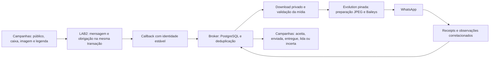

# Evolution, Baileys e campanhas com imagem — pesquisa e decisões

Data: 03/11/2026. Broker base `d1d0f2e6d7812865c39b1250454e238231b720b2`; LAB2 inspecionado em `a30fb50e`. A branch remota do Broker foi atualizada por fetch e não continha implementação posterior ao HEAD local. Nenhum deploy, migration, mudança de credencial ou novo envio real foi executado neste incremento.

## Conclusão comprovada

Existe um defeito reproduzível no contrato de mídia Broker → Evolution. O Broker gera nomes internos sem extensão; o motor pinado transforma imagens em JPEG e depois sobrescreve seu MIME a partir desse nome. O resultado observado na mídia sintética da tentativa investigada foi JPEG com MIME literal `false`. A correção local manda somente imagens com o nome técnico `image.jpg`. Legenda, bytes originais de entrada, limites, IDs e tratamento de resultado incerto foram preservados.

Ver [CORRECAO-IMAGEM-20261103.md](CORRECAO-IMAGEM-20261103.md) para RED/GREEN, prova com Sharp/Baileys reais, identidade do binário e limites da conclusão. O defeito foi corrigido localmente; entrega ao telefone ainda precisa de publicação controlada e recibo. Não atribuímos todos os incidentes históricos a esse único problema.

## O que a pesquisa externa mostrou

| Fonte primária | Aplicação ao nosso caso | Decisão |
|---|---|---|
| [Baileys: mensagens de mídia](https://baileys.wiki/messaging/media-messages) | Imagem e legenda pertencem ao mesmo envio. A biblioteca aceita Buffer, URL ou stream. | Preservar um efeito por destinatário; não separar automaticamente texto e imagem. Streams podem reduzir RAM, mas qualquer alteração requer manter limites, allowlist, checksum e controle de acesso. |
| [Evolution pinada: implementação](https://github.com/evolution-foundation/evolution-api/blob/fa09d37892cdbb1d65a250155d293d92230c5b30/src/api/integrations/channel/whatsapp/whatsapp.baileys.service.ts) | `prepareMediaMessage` converte JPEG em 2775–2777; em 2870–2871 usa novamente o nome para MIME; propaga esse valor em 2877–2879. | Compatibilidade mínima no adaptador, validada contra o método pinado. Não atualizar a engine inteira para corrigir um campo. |
| [Evolution issue 2459](https://github.com/evolution-foundation/evolution-api/issues/2459) e [PR 2471](https://github.com/evolution-foundation/evolution-api/pull/2471) | Relato de diferença `fileName`/`filename` na versão 2.3.7. No momento da leitura, PR aberta e issue encerrada sem comprovação de correção. | Não copiar o workaround de caixa do campo. No nosso código o contrato é `fileName`; usar nome JPEG coerente resolve o defeito reproduzido. |
| [Evolution issue 2512](https://github.com/evolution-foundation/evolution-api/issues/2512) | Relato de texto funcionando e anexo falhando na integração Chatwoot. | Pista de investigação, não prova da mesma causa. Neste caso os bytes chegaram à engine; não diagnosticar download como causa sem evidência. |
| [Baileys 7.0.0-rc.9: protobuf](https://github.com/WhiskeySockets/Baileys/blob/v7.0.0-rc.9/WAProto/WAProto.proto) e [recepção de receipts](https://github.com/WhiskeySockets/Baileys/blob/v7.0.0-rc.9/src/Socket/messages-recv.ts) | A enumeração distingue ERROR=0, PENDING=1, SERVER_ACK=2, DELIVERY_ACK=3, READ=4 e PLAYED=5. | Mapear status pela versão efetivamente pinada. Não chamar PENDING ou simples retorno HTTP de entregue. |
| [Baileys: sessão](https://baileys.wiki/authentication/session-management) | Credenciais e chaves Signal precisam ser persistidas juntas; o exemplo de arquivos não é recomendado para produção. | Validar o backend de estado já existente, suas falhas e recuperação. Não introduzir pasta de autenticação como substituição improvisada. |
| [Baileys: migração v7](https://baileys.wiki/migration/v7) | Mudanças de identidade LID/PN e armazenamento exigem compatibilidade do consumidor. | Testar mapeamentos persistentes e impedir que LID opaco seja interpretado como telefone. Não trocar a versão sem suíte de contratos. |
| [Evolution PR 2732](https://github.com/evolution-foundation/evolution-api/pull/2732) | Proposta de reconexão para outra linha de desenvolvimento. | Não aplicar cegamente: nosso pin já trata parte dos códigos. Provar cenários contra nossa imagem e preservar pareamento. |
| [Meta: envio de template com mídia](https://www.postman.com/meta/whatsapp-business-platform/request/2qbotrb/send-message-template-media) | Canal oficial usa contrato de template próprio. | QR com legenda e template oficial são jornadas distintas. O dispatcher atual rejeita HEADER não TEXT; suporte oficial a cabeçalho de mídia continua pendente. |

Também foram pesquisados Stack Overflow e fóruns/blogs. Os resultados encontrados tratavam principalmente de QR assíncrono, empacotamento Electron ou relatos sem reprodução. Nenhum deles demonstrou a correção deste MIME. A decisão técnica acima se apoia no código pinado, na documentação da biblioteca e na reprodução local, sem importar recomendações não verificadas.

Exemplos examinados e descartados como fundamento para esta correção: [Stack Overflow: resposta após escanear QR](https://stackoverflow.com/questions/78757029/how-to-get-the-successful-response-after-scanning-login-qr-code-from-baileys-api), [Stack Overflow: Electron e WhatsApp](https://stackoverflow.com/questions/79100359/electron-app-with-whatsapp-integration-works-in-development-fails-in-productio) e [fórum n8n: status PENDING](https://community.n8n.io/t/status-pending-ao-enviar-resposta/309946). São referências de triagem, não testes do Broker nem recomendações de patches.

## Fluxo a preservar



ACK do callback, aceite do provedor, entrega ao destinatário e custódia da mídia são fatos diferentes. A interface deve distingui-los. Timeout após a engine aceitar uma operação deve continuar UNKNOWN até existir evidência positiva; não repetir o envio automaticamente.

## Matriz de melhorias verificadas no código

P0: bloqueio direto da correção atual; P1: confiabilidade/segurança antes de ampliar operação; P2: operação e escala. PARCIAL não significa homologado em produção.

| Prioridade / área | Estado e evidência | Correção ou próximo teste de aceite |
|---|---|---|
| P0 — imagem com legenda | **Correção local testada.** `packages/providers/src/evolution/messaging.ts:207`; teste novo executa o formatter pinado. | CI do novo SHA, imagem identificada, publicação autorizada e uma tentativa correlacionada até receipt. Não repetir a tentativa antiga. |
| P1 — journal na origem | **PARCIAL.** `integrations/evolution-origin-journal/src/projection.mjs:1–5` captura notify TEXT individual; `engine-host.mjs:15–17` é lab-only. | Concluir instalação revisada e cobertura explicitamente suportada. COMMIT → crash → restart → receipt com mesmo ID/hash, perda de ACK e sem projeção duplicada. Não habilitar captura produtiva sem ownership comprovado. |
| P1 — status da engine | **Risco estático.** Upstream pinado em 1618–1621 usa fallback SERVER_ACK; 1648–1653 pode descartar update quando ainda não encontra a mensagem. | Testar status anterior à persistência, ausente, duplicado e atrasado. Guardar observação pendente e reconciliar sem inventar confirmação. |
| P1 — webhook 503 | **Causa real NÃO VERIFICADA.** `public-ingress-rate-limit.ts:48–53`: Redis indisponível; `routes/integrations.ts:64–86`: falha genérica de integração; existem guardas específicos de runtime/receipt. | Correlacionar código de resposta, requestId e horário com Redis/SQLSTATE. Reproduzir cada caminho isolado. Não atribuir 503 ao MIME. |
| P1 — logs sensíveis | **Risco estático.** Sanitização do Broker existe. Upstream `webhook.controller.ts:94–122` inclui data/sender/apikey no envelope e pode logá-lo. | Ler configuração efetiva sem expô-la; aplicar logger seguro no derivado. Testar payload hostil em sucesso/retry/falha e ausência de token, JID, QR, base64 e conteúdo nos logs. Não há comprovação de vazamento produtivo nesta leitura. |
| P1 — custódia de mídia | **PARCIAL.** `media-custody/service.ts:69–71` mantém KEEP e physicalStorageVerified=false; LAB2 sem integração de recibo encontrada em app/config/lib. | Persistir objeto definitivo e checksum no consumidor, emitir recibo idempotente e testar interrupção/perda de ACK. Manter KEEP até prova de custódia; sem exclusão prematura. |
| P1 — mídia de grupo | **LACUNA.** `qr-events.ts:145–160` trata texto de grupo; imagem/documento pode gerar normalização vazia e HTTP200. | Implementar fatos de mídia de grupo e identidade correspondente, ou diagnóstico explícito de não suportado. Testar duplicidade e restart sem converter participante em conversa individual. |
| P1 — credenciais e reconexão | **Homologação pendente.** Upstream `use-multi-file-auth-state-redis-db.ts:15–25` absorve erros de gravação; há saveCreds não aguardado em service.ts:1907. | Falhar de forma observável; testar Redis indisponível, round-trip BufferJSON, restart, 408/428/515, backoff limitado e um único proprietário da sessão. Não apagar nem migrar sessões reais para testar. |
| P2 — obrigação LAB2 | **IMPLEMENTADA, prova operacional parcial.** `message.rb:140–141`, `jrc_broker_webhook_obligation.rb:5–25`, job:20–78. | Preservar transação e identidade. Testar dois Sidekiq reais, Redis indisponível, lease substituído, worker atrasado e perda de ACK contra Broker real. |
| P2 — UNKNOWN, replay e ordem | **IMPLEMENTADOS com limites.** Dispatcher/repository mantêm UNKNOWN; state machine/status ledger e watermark evitam parte das regressões. | Aceite remoto seguido de timeout, falha de COMMIT local, status antecipado, mudança de binding e relógio retrocedendo. Replay de webhook não é reenvio ao WhatsApp. |
| P2 — fairness e observabilidade | **PARCIAL.** Broker distribui tenants; LAB2 recovery seleciona os 100 IDs mais antigos a cada minuto sem claim no scheduler. | Testar 101+ obrigações e múltiplas Accounts, registrar idade/fila/lease/código terminal por etapa. Adicionar admissão limitada e justiça entre Accounts se o teste confirmar starvation. |

O Broker já guarda IDs de anexo e consulta a mensagem novamente para obter URL atual (`chatwoot-worker.ts:398–412`, `chatwoot-client.ts:801–846`). Não há evidência de que guarde apenas uma URL assinada congelada. Ainda precisamos testar URL expirada, storage privado indisponível e renovação. Registrar separadamente hash do original e do JPEG derivado: conversão de imagem muda os bytes legitimamente.

## APIs reais relevantes

Inventário extraído de `docs/api/openapi.json`; cada rota mantém sua autenticação/escopo existentes. A presença no OpenAPI não comprova o comportamento em produção.

| Método e rota | Papel |
|---|---|
| POST `/v1/integrations/chatwoot/{id}/events` | Entrada de eventos Chatwoot. |
| POST `/v1/messaging/channels/{id}/messages` | Envio de template (`conversationId`, `name`, `language`, `variables`); não é uma rota genérica de texto QR. |
| POST `/v1/messaging/channels/{id}/partner-text` | Envio de texto pelo parceiro. |
| POST `/v1/messaging/channels/{id}/media` | Registro de mídia do canal. |
| GET `/v1/messaging/channels/{id}/media/{mediaId}` | Consulta de mídia no escopo do canal. |
| POST `/v1/messaging/channels/{id}/partner-media` | Solicitação de envio de mídia previamente registrada, com legenda opcional. |
| GET `/v1/messaging/conversations/{id}/messages` | Histórico de mensagens. |
| GET `/v1/messaging/conversations/{id}/qr-dispatch-attempts` | Tentativas QR correlacionadas. |
| GET `/v1/messaging/conversations/{id}/qr-outbound-observations` | Observações de saída QR. |
| POST `/v1/messaging/messages/{id}/retry` | Retry sujeito às regras existentes; não libera retry cego de UNKNOWN. |
| GET `/v1/partner-events` | Eventos disponíveis ao parceiro. |
| GET `/v1/partner-webhook-deliveries` | Entregas de webhook. |
| GET `/v1/partner-webhook-delivery-stats` | Estatísticas das entregas. |
| POST `/v1/partner-webhook-deliveries/{id}/replay` | Replay da entrega, preservando identidade. |
| POST `/v1/integrations/chatwoot/control/connections/{integrationId}/pair` | Operação de pareamento do módulo. |
| GET `/v1/integrations/chatwoot/control/connections/{integrationId}/status` | Estado da conexão. |
| POST `/v1/media-custody/receipts` | Registro de recibo de custódia, sujeito à autoridade específica. |
| GET `/v1/media-custody/receipts/{id}/retention` | Decisão atual de retenção. |
| GET `/v1/operations/health` | Diagnóstico operacional disponível. |

Exemplo estrutural verificado no schema atual, sem credenciais reais ou envio executado:

```http
POST /v1/messaging/channels/{channelId}/partner-media
X-JRC-API-Key: <chave-do-parceiro-no-tenant>
Idempotency-Key: <uuid-da-operacao>
Content-Type: application/json

{
  "conversationId": "11111111-1111-4111-8111-111111111111",
  "mediaId": "22222222-2222-4222-8222-222222222222",
  "caption": "Texto da campanha com imagem"
}
```

Os UUIDs acima são sintéticos. `mediaId` vem do upload autorizado no mesmo canal; a credencial precisa de `messaging:send` e `media:send`. O contrato também aceita `phoneNumber` no lugar de `conversationId`. A resposta é HTTP202 com identidade e estado da mensagem, não comprovante de entrega. A legenda tem limite de 1.024 caracteres; 16 MiB é o teto HTTP geral do upload, enquanto a validação de envio limita imagens a **5 MiB** e stickers a **500 KiB** (`packages/providers/src/media.ts`). A UI deve aplicar os limites do tipo, e não aceitar imagem de 16 MiB como enviável. O fluxo Campanhas do LAB2 usa seu callback específico; este exemplo é a API do parceiro, não uma instrução para contornar a UI.

## Ordem de execução

1. Finalizar regressão da correção de MIME e preparar candidata pequena, sem migration nem troca da engine.
2. Publicar somente após revisão/CI; validar uma imagem com legenda e receipt, sem reenvio automático de resultados incertos.
3. Fechar status, erros 503 e logs seguros com falhas reproduzidas e testes RED/GREEN próprios.
4. Completar cobertura durável da origem, custódia LAB2 e recuperação de sessão em infraestrutura isolada real.
5. Homologar texto, imagem, PDF, áudio e vídeo nos dois sentidos, com falhas de storage/Broker/Redis/SQL, isolamento e deduplicação.
6. Medir fila, memória por mídia e justiça entre tenants em carga sintética progressiva; depois piloto real autorizado. Não declarar capacidade de 50/400/900 sessões a partir destes testes de codec.

As etapas futuras não estão incluídas na correção mínima de MIME. Não foram executados backup, dump, restore, replay produtivo, alteração de engine ou conexão de números reais.
