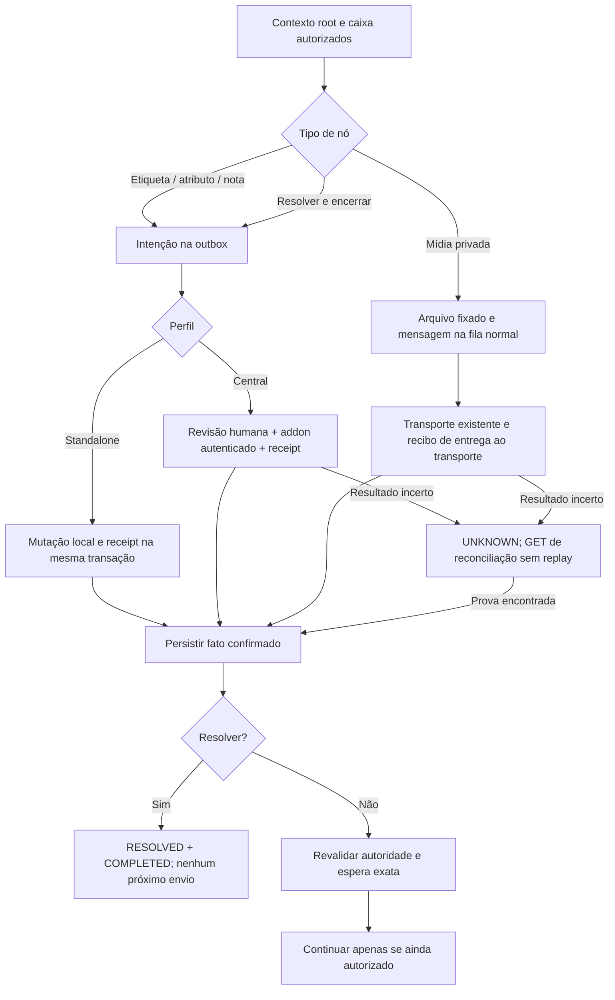

# P3 ações e mídia — Implementation Plan

> **For agentic workers:** REQUIRED SUB-SKILL: Use superpowers:executing-plans to implement this plan task-by-task. Steps use checkbox (`- [ ]`) syntax for tracking. Não criar agentes adicionais nem fazer commit/push; o coordenador distribui fronteiras e integra o corte.

**Goal:** entregar os cinco nós no console e editor nativo, com recursos privados, escopo atual e confirmação durável, corrigindo B1–B6.

**Architecture:** integrar somente deltas revisados do candidato no motor/outbox/storage/transportes existentes. Quatro ações centrais usam addon com receipt atômico e revisão humana; mídia usa messaging. Prova persistida do fato e autorização para continuar o motor são decisões distintas.

**Tech Stack:** TypeScript, Zod, Fastify, PostgreSQL/RLS, React, Rails/ActiveRecord, providers privados INLINE/C2.

**Spec:** `docs/superpowers/specs/2026-10-15-p3-acoes-midia-integradas-design.md`.

**Approval:** desenho aprovado; implementação Broker liberada em 15/10/2026 após `3b15ef6648e708e97d5c59a1b7aa625f491559fc`. B1–B6 e contratos estão descritos na spec versionada; nenhum artefato ignorado é requisito para entender ou executar os gates.

## Global Constraints

- Preservar a base integrada `3b15ef6648e708e97d5c59a1b7aa625f491559fc`; o congelamento de produto/testes Broker foi encerrado pelo coordenador.
- Migration Broker0063 reservada para P3; Rails `20261015150000` reservada. Preservar0058/0060/0061/0062 e migration NICO Rails20261015130000.
- Não aplicar candidate.patch inteiro nem copiar tree/composed-base. Registrar SHA do HEAD após liberação e verificar manifest do candidato.
- Preservar input timeout, waitId, deadline, scheduler, CAS/settleTerminal/handoff, NICO OPEN, native bind, Fleet/QR/C2 e contratos de grupo.
- Autorizações root/tenant/canal/Inbox atuais antes/depois de I/O. Zero HTTP sob transação PostgreSQL/Rails.
- Upload binário separado: máximo16MiB mais limites por tipo; auth/control16KiB e grafo2.200.000 bytes conservados.
- Nunca repetir mutação DISPATCHED/UNKNOWN por tempo; sem segredos, texto de nota/cliente, bytes ou proofs nos logs.
- Resolve é terminal, `Resolver e encerrar`, sem envio automático posterior. Cinco nós indisponíveis durante integração; liberar após todos os gates por perfil.
- PG Broker em janela exclusiva do laboratório local; Rails no laboratório do coordenador. Somente focais novos/afetados durante implementação; root executa checks globais do corte.

## Review Focus

- Próprio echo pendente antes do ACK não bloqueia sua confirmação, mas callback falso/humano/NICO e outra tentativa bloqueiam: tarefas3–5.
- Dois canais de uma empresa e IDs remotos iguais de duas empresas nunca compartilham recurso/receipt/permissão: tarefas2,4,6.
- Campo int8 real retorna string, números/Unicode diferem entre runtimes e v1 antigo não vira autorização v2: tarefas1,2,4.
- Crash entre receipt e settlement conserva o fato, sem segundo POST nem reativação de execução tomada: tarefas3–5.
- Resolver fecha um ciclo; inbound novo confiável pode seguir política atual, mas mensagem antiga e IO de subflow anterior não reabrem: tarefas1,3,7.

## Fluxo dos cinco nós

## Task 1: contratos, markers e efeitos no mesmo motor

**Files:** criar `packages/contracts/src/automation-conversation-effects.ts`, `packages/providers/src/media-upload.ts`; alterar exports, `automation-node-definitions.ts`, `automations-v1.ts`, `automation-integrations/importer.ts`, `automations/types.ts`, `engine.ts`, `simulation.ts`; adicionar unit tests do candidato corrigidos.

**Interfaces:** conservar `executeAutomation(...)` e `RuntimeResult`; ampliar `RuntimeEffect` com IO_CONVERSATION/SEND_MEDIA. Configuração nova usa `conversationEffectVersion:2`/`mediaEffectVersion:2`, channelId e referências/revisões. Resolve é terminal, sem portas. Outros quatro nós têm success/error/timeout, sendo error/timeout permitidos somente com certeza de não despacho; UNKNOWN é pendência diagnóstica sem avanço. `ConversationEffectWait` e `ActionSimulationResponse` carregam identidade da espera/outbox, além de nodeId. v1 permanece legível sem execução implícita.

- [ ] Escrever RED de schema: cinco configurações novas; resolve com aresta de saída recusado; tag/attribute/note/media sem referência autorizada não publicam; v1/histórico não migra por inferência; import remove autoridade externa.
- [ ] Escrever RED motor/simulação: dois ciclos do mesmo nodeId rejeitam resposta antiga; subflow preserva definição/versão; resolve finaliza sem próximo SEND; resposta UNKNOWN mantém espera exata e apenas altera diagnóstico; timeout anterior ao despacho segue porta, timeout após despacho permanece UNKNOWN; input com deadline/waitId mantém comportamento0061.
- [ ] Executar apenas `automation-conversation-contract.test.ts`, `automation-conversation-engine-simulation.test.ts` e testes de importer/contrato afetados; registrar falhas funcionais.
- [ ] Integrar os deltas e adaptar marker/espera/terminalidade; não copiar arquivos compartilhados divergentes. Manter catálogo indisponível.
- [ ] Rodar os mesmos focais e typecheck de contracts/providers/API. Revisar compatibilidade de snapshots publicados antes de avançar.

## Task 2: recursos, upload privado e escopo

**Files:** criar `conversation-effects-repository.ts`, `conversation-resources.ts`; alterar `media-store.ts`, `durable-private-media.ts`, `automations/service.ts`; testes novos `integration/automation-conversation-resources.test.ts`, `http/automation-conversation-upload.test.ts` e unidades de upload/scope.

**Interfaces:** `createConversationResourceService(options)` fornece `actionCatalog`, `saveResource`, `uploadMedia`, `mediaCatalog`, `revokeMedia`, `refreshGraphs`; `assertConversationResourcePolicies(tx,org,root,graphs,pin?)` valida root/subflows e pins. `readActionResource` converte/valida remote_id int8 real; `MediaStore.writeUpload` recebe callback de autorização atual e idempotencyKey.

- [ ] Escrever RED PG com dois tenants, duas caixas por tenant, IDs remotos iguais e remote_id retornando string; root não pode listar/upload/revogar em caixa não concedida.
- [ ] Escrever RED HTTP para tamanho antes de parse, MIME/assinatura, chave repetida com bytes diferentes, quota, estado STORING/REVOKED, C2 PUT incerto e revogação durante leitura.
- [ ] Executar focais e capturar falhas reais. Integrar apenas fachada UPLOAD mantendo C2, lifecycle e os descritores existentes.
- [ ] Validar policies de publicação em subflows e pins que impedem descarte de arquivo publicado. Não usar UUID/revision recebido como prova de acesso.
- [ ] GREEN PG como jrc_app, HTTP e unidades de provider/storage. Sem contato com storage de produção.

## Task 3: autoridade por intenção, standalone visível e resolver terminal

**Files:** criar `conversation-effect.ts`, `conversation-runtime.ts`, `conversation-effect-proof.ts`; integrar `conversation-effects-repository.ts`, `automations/repository.ts`, `service.ts`, `commands/automation-worker.ts`; projeção em `messaging/service.ts`, `repository.ts`, contratos/rotas de detalhe; criar migration `0063_automation_effect_control.sql` e readiness correlato.

**Interfaces:** `createConversationEffectDispatcher(ports).dispatch(item)` preserva `OutboxDispatchResult`; `assertEffectAuthority(tx,item,expected?,requireLease?)` é para admissão. A confirmação usa `assertPersistedEffectAuthority(tx,item,intentId)` e `recordConfirmedEffect(tx,receipt)` separados. `settleResolvedConversationEffect(tx,item,receipt)` fecha sessão/execução/outbox atomicamente, sem chamar resumeExecution.

0063 deverá acrescentar somente a correlação que0058 não fornece: vínculo entre observação de controle e intenção, estado de prova e revisions antes/depois. `automation_effect_observations` identifica org/canal/conversa/ciclo/outbox/observation e transição; índices/keys/RLS/grants/readiness/purge seguem os ledgers existentes. A identidade e os fatos confirmados são imutáveis. Campos finais dependem da API de revisão humana do addon, mas não requerem reescrever0058.

- [ ] Escrever RED PG: merge concorrente de etiquetas/chaves locais; nota não cria mensagem pública/outbox; projeção retorna somente notas privadas autorizadas; resolve fecha sessão+execução+receipt/outbox na mesma tx.
- [ ] Escrever RED tomada/revogação entre prepare/commit, duas tentativas e crash depois do receipt; replay não duplica nota nem retoma execução cancelada. NICO OPEN continua impedindo efeito mesmo com checkRemote=false.
- [ ] Executar focais. Integrar dispatcher/runtime e leitura do atendimento; tratar fatos confirmados e permissão para continuação separadamente.
- [ ] Implementar0063 nova e probe/purge/grants. Rodar migração upgrade e RLS jrc_app do novo ledger.
- [ ] GREEN standalone e roteamento após resolve: inbound novo confiável segue novo ciclo/política atual, evento antigo não ressuscita execução.

## Task 4: addon Rails com quatro ações e protocolo de bytes

**Files JRC propostos:** controller `api/v1/accounts/jrc_flow_effects_controller.rb`; model `jrc_flow_effect_receipt.rb`; services `jrc_flow_effects/{authority,apply,receipt_digest}.rb`; concern de revisão humana somente se não houver epoch existente suficiente; migration `20261015150000_create_jrc_flow_effect_receipts.rb`; routes e filter initializer. Request/service specs correspondentes. Coordenar esses paths com o agente dos66 módulos antes de alterar qualquer JRC/installer.

**Interfaces:** GET capabilities/context, POST effect e GET receipt conforme desenho `jrc-conversation-effects/2`. `Apply.call(account:,actor:,conversation:,input:)` trava/revalida, muta e grava receipt. `ReceiptDigest.call(input:)` usa sequência de bytes especificada; `value_json` é interpretado e validado, nunca reserializado para calcular hash.

- [ ] Fixar o adaptador de revisão humana: inspeção de mecanismos existentes e teste concorrente de Message humana/assignment/status/NICO versus POST. Sem cobertura atômica, capabilities permanece indisponível; não substituir por timestamp/hash de estado.
- [ ] Escrever RED Rails: token errado/AgentBot/revogado, Inbox/contato trocado, recurso/revisão antiga, valor tipado inválido, same op+different proof/body, receipt replay e dois tenants com IDs iguais.
- [ ] Escrever golden vectors compartilhados Node/Ruby para UTF-8, escapes, false,0,fração/expoente; normalizar int8 sem arredondar.
- [ ] Implementar tag aditiva, atributo por chave, note private no builder normal e resolve explícito, todos com receipt transacional e revisão esperada. Nenhum HTTP sob locks Rails.
- [ ] GREEN Rails real incluindo concorrência humana, ACK perdido e crash/replay. Integrar paths ao manifest/installer do JRC atual preservando QR; não publicar instalação externa nesta etapa.

## Task 5: central/media e reconhecimento de efeitos próprios

**Files:** `conversation-central.ts`, `conversation-media.ts`, `conversation-effect-proof.ts`, `messaging/central-dispatcher.ts`, `messaging/repository.ts`, `integrations/chatwoot-client.ts`, `chatwoot-attendance-store.ts`, `chatwoot-attendance-events.ts`; testes `integration/automation-conversation-central.test.ts`, `automation-conversation-media.test.ts`, `automation-conversation-control-events.test.ts`.

**Interfaces:** `createConversationCentralAdapter(options)` expõe catalog/dispatch/reconcileOnce; `createAutomationMediaBridge(options)` expõe enqueue/reconcileOnce. `assertQueuedMediaAuthority` valida intenção própria sem ignorar gate global; `confirmQueuedMedia` registra transporte antes de decidir retomada. Prova canônica sempre fora de transação.

- [ ] Reproduzir B1 com media.read após mirror DISPATCHED; outro attempt UNKNOWN ainda deve bloquear. Reproduzir B2/B3 com note/resolve callback antes/depois ACK, metadata forjada e callback humano comum.
- [ ] Corrigir identificação por intenção/proof/ciclo e cadeia de revisions própria. Callback sem receipt vira pendência, nunca permissão de envio; callback validado de outro ciclo não reabre execução atual.
- [ ] Integrar protocolo/2 e int8 normalizado. Falha antes do POST é definitiva quando comprovada; resposta perdida vira UNKNOWN e só GET pode reconciliar. Preservar fato remoto quando a autoridade local já foi perdida.
- [ ] Testar CENTRAL_MEDIA, QR e Meta sintéticos: enqueue não conclui; ACK/canonical proof conclui uma vez; MIME/sha256/anexo incongruente recusa; takeover durante leitura e ACK tardio preservam HUMAN. Caso adicional0062: mídia ACCEPTED cancelada antes de dispatch conclui REJECTED/CANCELED sem retomar Flow e libera DRAINING; intento de transporte DISPATCHED/UNKNOWN não recebe essa exceção.
- [ ] GREEN com ledger real/jrc_app e HTTP recording. Nenhum relaxamento global de attendance gate ou replay mutador na reconciliação.

## Task 6: APIs normais/delegadas, BFF e composição

**Files Broker:** `http/routes/automations.ts`, `http/routes/flow-delegation.ts`, `flows/delegation/service.ts`, `integrations/runtime.ts`, `app.ts`. **JRC:** cliente/control/editor operation allowlist e streaming upload nos paths existentes, em coordenação com o agente JRC.

**Interfaces:** métodos delegados `actionCatalog`, `saveActionResource`, `mediaCatalog`, `revokeMedia`, `uploadMedia` sempre recebem sessão/root/channel e verificam definition scopes/grants atuais nas duas fronteiras. `graphScope` percorre os novos markers em root/subflow. Injeção de media/catalog em serviços normal e delegado.

- [ ] Escrever RED HTTP/BFF: caixa não autorizada no mesmo tenant; scopeRevision obsoleto; subflow com mídia fora de grants; revogação durante download/catalog; upload binário fora de graph envelope.
- [ ] Compor dependências sem perder runtime Fleet, groupPolicy, native bind, chatwoot takeover e auth; aplicar limites atuais sem aumentar envelopes globais.
- [ ] Mapear operações explicitamente no transporte BFF; nunca usar listChannels da console como autoridade no editor embutido.
- [ ] GREEN HTTP/BFF/PG; revisar que erro409/403 não expõe dados de outra caixa e catálogo indisponível informa capacidade real.

## Task 7: UI, leitura standalone, simulação e liberação

**Files:** `ConversationActionEditor.tsx`, `conversation-api.ts`, `ActionSimulationControl.tsx`, `SimulationWaitControl.tsx`, `FlowCanvas.tsx`, `AutomationStudio.tsx`; detalhe de conversa em `apps/web/src/pages/Messaging.tsx` e componentes existentes; testes UI correspondentes. Contratos/paleta e `docs/automations/node-capabilities.md` no fechamento.

**Interfaces:** `ConversationActionContext` contém root/channel/transport autorizado; requests têm AbortSignal e identidade de contexto. A resposta de simulação contém waitId/outboxId; resolve terminal apresenta `Resolver e encerrar` sem conector para próximo envio.

- [ ] Escrever RED UI para seleção por nome/tipo/arquivo, ausência real de capability, troca de tenant/root/caixa durante catálogo/upload e resposta tardia; notas locais aparecem apenas na projeção privada.
- [ ] Escrever RED simulação: somente espera atual aceita resposta; resolve finaliza; input deadline existente permanece disponível; simulação não chama rede.
- [ ] Integrar UI contextual sem expor IDs técnicos. Grupos mantêm política restrita. Renderizar erro/entrega/incerteza em estados distintos.
- [ ] GREEN UI+journey sintética dos cinco nós normal/delegado; revisar microcopy e marcadores antigos.
- [ ] Após gates1–7, liberar as cinco entradas no catálogo e capabilities por perfil suportado; atualizar OpenAPI/auditoria/docs. Root executa suite obrigatória, build/typecheck e revisão do corte, registra SHAs/componentes e decide commit/publicação candidata. Sem deploy de produção.

## Estado do corte em integração

O freeze foi liberado em `3b15ef6648e708e97d5c59a1b7aa625f491559fc`; a base posterior `4a7decdd4e57dc2c25e37b6089fa6f2fcfe571f6` passou o CI. A revisão humana usa epoch PostgreSQL sob a mesma trava Conversation, com addon e paths coordenados. Markers v2, resolve terminal e UNKNOWN sem ramo executável estão implementados. Os checkboxes acima permanecem uma lista de gates de aceitação; não representam uma nova espera por aprovação.

A implementação final usa `0063_conversation_effect_protocol.sql` e `automation_effect_control_steps`. A prova/continuação está separada no adaptador central e no bridge de mídia; os nomes de interface propostos nas tarefas podem diferir dos nomes finais. Consulte a [evidência focal rastreada](../../validation/2026-10-15-p3-effects-broker.md) para resultados confirmados e pendências. O coordenador controla a liberação das cinco entradas de criação, suíte integrada, commit e publicação candidata.

## Fechamento da implementação candidata

As sete tarefas têm implementação integrada no candidato. Os nomes de arquivos acima são os propostos no planejamento; os caminhos finais e resultados reproduzíveis constam nos registros de validação. Os checkboxes conservam os critérios originais, incluindo combinações cuja prova completa depende do CI e da homologação instalada; não significam sete tarefas de programação ainda por iniciar.

- [x] Contratos v2, importação sem autoridade externa, motor e simulação com espera exata e resolve terminal.
- [x] Recursos por caixa/raiz, arquivos privados, idempotência por bytes e autorização durante o armazenamento.
- [x] Dispatcher durável, projeção privada standalone, migração0063, readiness e registro de purge.
- [x] Addon Rails protocolo2 e recibo transacional, com 38 exemplos PostgreSQL reais aprovados.
- [x] Adaptação central/mídia, confirmação tardia e recuperação sem repetir mutações, incluindo asset de subfluxo.
- [x] Rotas normais/delegadas, BFF, contratos de upload binário e inventário explícito de329rotas.
- [x] Formulários compartilhados/nativos e cinco entradas AVAILABLE, após132testes do catálogo/motor/canvas aprovados.
- [ ] Registrar CI e imagens do commit final. A instalação candidata e os testes físicos seguem o roteiro Dokploy; nenhum deploy de produção faz parte deste fechamento.
