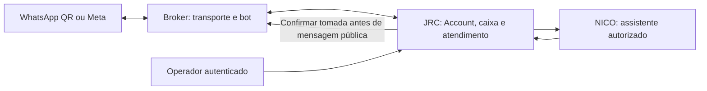

# Instalação e homologação do candidato Broker/JRC/NICO

Branch autorizada nos dois repositórios: `codex/nico-broker-coordenado-20261015`. Este roteiro prepara uma instalação separada. A branch e a imagem do JRC Conversas mantidas pelo outro desenvolvedor permanecem em produção. Nenhum deploy de servidor foi executado pelo agente neste incremento.

## O que será instalado

| Componente | Fonte e função | Imagem |
| --- | --- | --- |
| Broker API e workers | `ClaudioHideki/BrokerJRCIA`; canais, motor único de automação e coordenação do atendimento | Mesmo digest API em API, workers e migrador |
| Broker web | Mesmo repositório; console e editor Flow | Digest web do mesmo corte de fonte |
| JRC Rails e Sidekiq | `ClaudioHideki/jrc-conversas-lab2`; base `b58e093dd3a32fe97829a4566660b83ee48b9eca`, módulos nativos e assistente NICO | Mesmo digest app nos dois serviços |
| NICO runtime | Serviço de inferência usado pelo Rails; não abre conexão WhatsApp | A imagem do runtime não mudou com a correção de histórico nem com a coordenação de envio |

As referências finais de imagem e seus commits ficam no [registro da publicação candidata](2026-10-15-nico-broker-candidato.md). A imagem JRC inicial `8ea57072…` contém somente a correção de histórico; não deve ser apresentada como imagem de todos os incrementos posteriores. Usar apenas um conjunto com fonte, CI e digests registrados para o incremento que será homologado.



O NICO cria a mensagem pelo canal da central depois da pausa confirmada. Não abre outra conexão WhatsApp e não retoma o bot ao concluir ou cancelar. Usuários continuam no JRC; não precisam ser copiados em massa para o Broker. A sessão do operador e os grants atuais limitam as ações delegadas por Account e caixa.

O módulo Flow do JRC usa o mesmo canvas e contratos da console Broker, através de um BFF autenticado pela sessão do operador no JRC. A edição recebe um escopo fixo de Account, usuário, caixas e fluxo; credenciais Broker permanecem no backend. O módulo QR é uma entrada separada para conectar e reconectar os números. Ambos utilizam o motor e transporte do Broker. O runtime NICO continua separado, como assistente autorizado.

Para reproduzir o pacote de editor durante desenvolvimento, a partir do checkout Broker com fonte já commitada:

```sh
npm run build:native-flow-editor -- --install-jrc CAMINHO_DO_CHECKOUT_JRC_CANDIDATO
```

O comando exige uma branch `codex/` no checkout JRC, gera `public/jrc-flow-editor` com manifesto e licenças e atualiza o módulo de versão do editor. Esses arquivos entram no commit e na imagem candidata JRC, junto dos módulos e migrations. Não executar no servidor de produção: o servidor recebe a imagem pronta. O CI Broker testa o bundle compilado; o manifesto de composição JRC confere os arquivos instalados. Para habilitar a execução nativa em caixas da central, seguir também a instalação do observer e dos guards registrada no pacote de composição; copiar somente o JavaScript não instala a coordenação dos executores.

## Preparar o ambiente no Dokploy

1. Criar projetos/serviços candidatos com domínios HTTPS próprios, por exemplo `broker-hml` e `conversas-hml`. Usar a branch candidata e o Compose do mesmo commit da imagem.
2. Criar PostgreSQL, Redis, volumes e bucket/prefixo privados da homologação. Não apontar os candidatos para o banco, Redis, storage ou volumes de sessão WhatsApp da produção. Se houver runtime NICO candidato, usar endpoint e credencial próprios; a imagem pode ser a mesma já aprovada.
3. No JRC, Rails e Sidekiq devem usar exatamente a mesma imagem app e a mesma configuração candidata. Preservar o serviço runtime como componente separado. Não trocar o repositório por `jrc-conversas-nico-v12-2-7-comercial-integrado`, que não representa a base atual do JRC.
4. Criar duas Accounts de homologação e seus usuários/agentes. Anotar os IDs efetivamente gerados; 3 e 4 abaixo são exemplos de Accounts existentes, não uma instrução para forçar esses IDs no banco.
5. Usar um número de WhatsApp de testes. Uma sessão Evolution não pode ficar ativa em dois ambientes ao mesmo tempo. A conversa pessoal do Welton está autorizada para homologação, mas não copiar sua sessão produtiva para um segundo container.

Não substituir todo o ENV pelo exemplo do repositório. Configurar os segredos diretamente no cofre/Environment do serviço candidato. Não enviar senhas, chaves ou tokens para o chat, Git ou logs.

## Banco do Broker

O Compose possui serviço `migrate` no perfil `maintenance`. **General → Deploy sozinho não executa esse perfil**, e os workers não aplicam migrations ao iniciar.

Os exemplos a seguir são para **Advanced → Run Command**, cujo painel acrescenta `docker`. Substituir `NOME_DO_COMPOSE_CANDIDATO` pelo App Name real do novo serviço Dokploy, nunca pelo nome da produção. Salvar e clicar General → Deploy após cada comando temporário.

Em uma instalação nova, iniciar primeiro PostgreSQL e Redis:

```text
compose -p NOME_DO_COMPOSE_CANDIDATO -f ./infra/dokploy/compose.yaml up -d postgres redis
```

Aplicar o schema com a imagem API candidata selecionada no Environment:

```text
compose -p NOME_DO_COMPOSE_CANDIDATO -f ./infra/dokploy/compose.yaml --profile maintenance run --rm --no-deps migrate
```

Exigir saída sem erro e `Schema and dedicated roles provisioned.`. Conferir o journal com a credencial exclusiva do migrador:

```text
compose -p NOME_DO_COMPOSE_CANDIDATO -f ./infra/dokploy/compose.yaml --profile maintenance run --rm --no-deps --entrypoint /bin/sh migrate -c 'SCHEMA_STATUS_DATABASE_URL="$MIGRATION_DATABASE_URL" node /app/apps/api/dist/db/schema-status.js'
```

Esperado: `CURRENT`, `compatible: true`, nenhuma migration pendente e versões esperada/aplicada iguais ao corte da imagem registrado na publicação. Não usar o terminal da API para ler o journal: a role `jrc_app` não tem essa permissão.

Neste corte, a última migração Broker é `0064_native_flow_guard_coverage` (inclui 0061 de captura, 0062 de tomada NICO e 0063 de efeitos). A 0064 exige a prova dos 19 pontos de execução nativos; uma prova antiga ainda em `DRAINED` passa a `UNKNOWN` para reconciliação, sem repetir a troca de executor. Vínculos já ativados, automações e mensagens permanecem intactos. O JRC tem migrações próprias para registro/instalação/ownership nativo, envio NICO, recibos das ações e proteção de configuração por caixa; a imagem Rails e a Sidekiq precisam conter e usar o mesmo conjunto. A imagem NICO runtime não recebe essas migrações.

Depois **apagar todo o campo Advanced → Run Command**, salvar e usar General → Deploy. Isso inicia a aplicação e todos os workers com o comando normal. Não deixar o comando de migração no campo: o container pontual termina e não inicia o sistema.

Ao atualizar um candidato já em uso, parar somente `web api worker automation-worker automation-io-worker scheduler-worker lifecycle-worker` antes da migração; preservar PostgreSQL, Redis e Evolution. Não usar `down --volumes` nem restaurar um banco antigo para desfazer uma imagem sem verificar a compatibilidade.

## Configuração e banco do JRC

No banco candidato já inicializado, executar no serviço Rails candidato, antes de iniciar os consumidores novos:

```sh
bundle exec rails db:migrate
```

Em um banco novo, usar o provisionamento inicial do JRC (`db:chatwoot_prepare`) e depois conferir as migrations do candidato. O entrypoint Rails aguarda o PostgreSQL, mas não substitui a execução explícita de migrations. A migração `20261015130000_create_nico_broker_send_operations` pertence ao envio coordenado; os módulos adicionais registram suas próprias migrations e instruções no pacote de composição.

Na configuração privada do Rails **e** Sidekiq candidatos:

| Configuração | Valor/finalidade |
| --- | --- |
| `FRONTEND_URL` | Origem HTTPS canônica do JRC candidato |
| `JRC_BROKER_ENABLED` | `true` para disponibilizar a integração |
| `JRC_BROKER_ALLOWED_ORIGINS` | Origem HTTPS canônica do Broker candidato, sem caminho nem barra final |
| `JRC_BROKER_CREDENTIAL_KEY` | Chave dedicada, base64 de 32 bytes, guardada no cofre; preservar para ler as credenciais cifradas |
| `NICO_RUNTIME_URL` + `NICO_SERVICE_TOKEN` | Endpoint e credencial da instalação runtime escolhida, quando não se usa o roteamento por Account |
| `NICO_RUNTIME_ROUTES` | Quando configurado, cada Account precisa de sua entrada explícita; uma Account não mapeada não utiliza o runtime de outra |
| `NICO_MODE` | Preservar o modo escolhido; `provider` utiliza o provedor da Account configurado pelo backend |

No Broker candidato, conservar `AUTOMATION_RUNTIME_V2_ENABLED=true` e configurar `CHATWOOT_CONTROL_ENABLED=true` para o controle autenticado. Para um destino externo à central padrão, usar `CHATWOOT_EXTERNAL_DESTINATIONS_ENABLED=true` e aprovar a origem/Account pelo fluxo administrativo. `EVOLUTION_BASE_URL` no Compose aponta para `http://evolution:8080`. O token Platform App é uma capacidade administrativa distinta da credencial da Account; não é necessário copiar o token global para agentes ou navegador.

Para cada Account, habilitar também a feature `jrc_broker` da instalação e configurar na interface a integração com origem Broker, organização correspondente e credencial de controle da própria Account. Essa feature é separada de `nico_enabled`; habilitar o NICO não habilita o módulo QR automaticamente. O ID numérico da Account e o UUID da organização Broker são identidades diferentes; não presumir igualdade. O backend valida Account, origem, organização e revisão do destino antes de salvar. Vincular a caixa existente ou criar pelo assistente; escolher os agentes autorizados. QR/reconexão exige grant atual, não apenas o conhecimento do ID da caixa.

## Habilitar NICO para a Account 3 ou 4

No Open Terminal do serviço **Rails da instalação desejada**:

```sh
bundle exec rails runner 'a = Account.find(3); a.with_lock { a.update!(custom_attributes: a.custom_attributes.merge("nico_enabled" => true)) }; puts "NICO habilitado na Account #{a.id}"'
```

Para habilitar a Account 4, substituir apenas `3` por `4`. O comando preserva os demais atributos. A Account precisa estar ativa; configurar seu próprio provedor, modelo padrão e limites em Inteligência Artificial. Não aumenta permissões, não envia mensagens e não ativa o bot. Não executamos essa habilitação para 3/4 no servidor.

O runtime selecionado também precisa aceitar o ID. No serviço **NICO runtime candidato**, configurar `NICO_ALLOWED_ACCOUNTS` com os IDs explicitamente autorizados, separados por vírgula: por exemplo `1,3,4` quando essas três Accounts utilizarem aquela implantação. Preservar os IDs já atendidos; não usar `*` para liberar todos. Essa variável é lida na inicialização: salvar e reimplantar somente o serviço runtime candidato após a alteração. Não exige reconstruir a imagem. `NICO_MODE=provider` exige o provedor da própria Account enviado pelo Rails, além da autenticação de serviço.

Também é possível manter um runtime separado por Account (`NICO_ALLOWED_ACCOUNTS=3` ou `4`) e configurar `NICO_RUNTIME_ROUTES` no Rails e Sidekiq com cada endpoint e seu `token_env`. Nesse caso, incluir todas as Accounts que continuarão atendidas: a ausência de um ID no mapa retorna `account_not_configured`, sem fallback. Guardar cada `NICO_RUNTIME_TOKEN_...` somente no Environment/cofre, com pelo menos 32 caracteres; nunca na interface do navegador. O mapa e a lista do runtime são configurações diferentes e ambas precisam corresponder à Account.

O comportamento acima foi conferido em `services/nico-runtime/src/server.ts`, `provider-config.ts` e no `JrcNico::RuntimeClient` da base atual. A observação antiga no README do runtime sobre uma única Account em provider não representa a implementação atual da lista explícita. Habilitar a flag no banco sem ajustar uma lista restrita a `1` continuará produzindo `account_not_configured` para 3/4.

Consulta sem alterações:

```sh
bundle exec rails runner 'a = Account.find(3); puts({account_id: a.id, nico_enabled: a.custom_attributes["nico_enabled"]}.to_json)'
```

## Homologação funcional, uma vez por corte

Registrar antes do teste: commit e digest efetivos de cada container, migrations, Account/organização, caixa, versão publicada do Flow, horário e correlações. Não registrar conteúdo de clientes, QR ou segredos.

| Jornada | Resultado que precisa ser observado |
| --- | --- |
| Conexão QR | Número correto, vínculo persistido e status consistente após recarregar; permissão revogada impede obter QR/reconectar |
| Flow | Criar pelo canvas, salvar, simular, publicar e vincular a caixa; o cliente recebe exatamente o menu publicado |
| Menu e captura | Escolha avança uma vez; captura grava a resposta; prazo sem resposta segue somente o timeout configurado |
| Handoff | Transferência chega ao time/agente autorizado; bot fica pausado; resposta humana não cria segunda execução |
| NICO consulta | Resume o contexto recente e consulta módulos somente dentro da Account e das permissões do operador |
| NICO envio | Exibe prévia; confirmar pausa antes de criar uma mensagem pública; retorno duplicado/reinício não envia novamente; atendimento continua humano |
| Cancelamento/revogação | Cancelar antes da criação impede envio tardio; remover acesso/usuário ou mudar destinatário invalida a operação; uma mensagem já criada permanece um fato a reconciliar |
| Retomada | Ação explícita cria a sessão/ciclo escolhido; não ocorre retomada automática depois de envio/cancelamento do NICO |
| Mídia | Mensagem/anexo aparece no aparelho e nos históricos; enfileirar ou registrar na central não é declarado como entrega ao WhatsApp |
| Segunda Account | Não vê credenciais, caixas, contatos, fluxos, mídia nem operações da primeira, inclusive com IDs remotos numéricos repetidos |

As ações de etiqueta/atributo/nota/resolução e os módulos QR/Flow devem seguir também o contrato e a matriz de seu incremento efetivamente publicado. Não marcar uma ação como homologada por existir na paleta. Meta depende dos ativos/autorização oficiais; Chatwoot externo depende de uma instalação disponibilizada depois pelo usuário. Capacidade de 500 empresas/10 mil conexões depende de teste de carga, orçamento de conexões PostgreSQL, particionamento/frota Evolution e medições reais; não é inferida de testes unitários.

Readiness, CI e testes sintéticos são evidências diferentes da conversa real. Se houver resultado incerto, conservar o registro e reconciliar o mesmo efeito, sem repetir envios ou trocas de executor às cegas.
